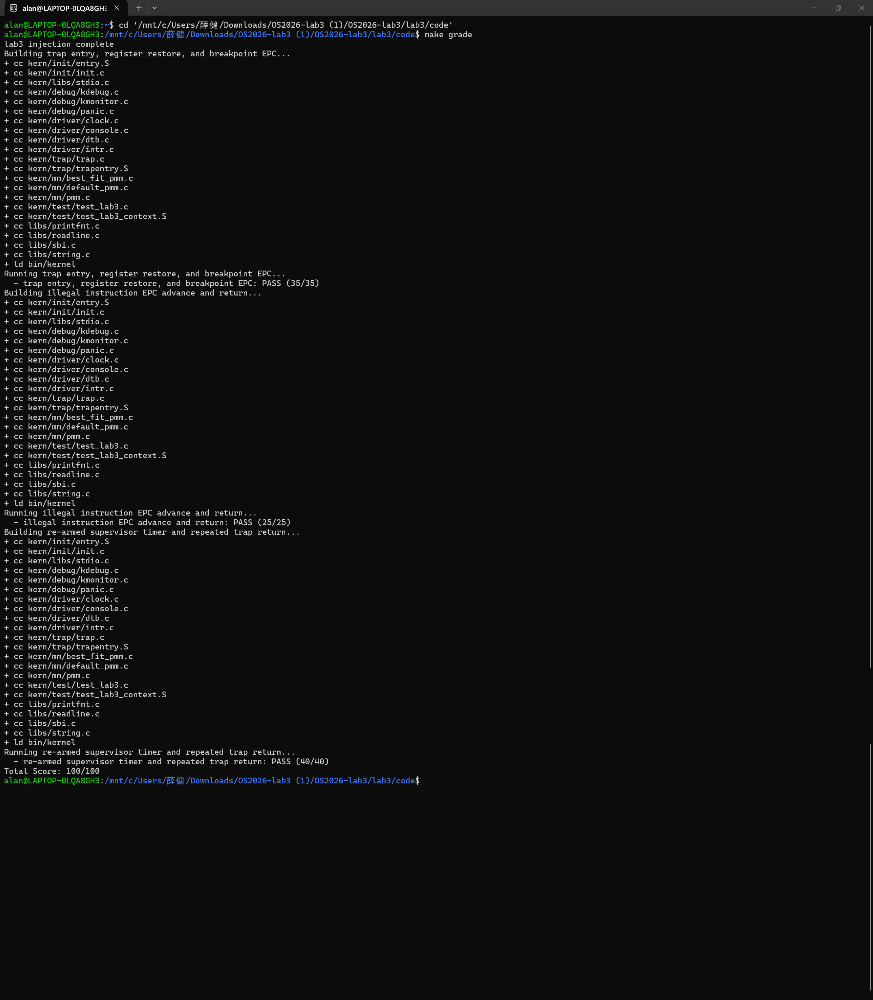

# 操作系统实验报告

## 实验基本信息

| 项目 | 内容 |
|------|------|
| **实验名称** | Lab 3: 中断处理机制 |
| **小组成员** | 2414010-严子涵、2411641-薛健、2413777-施骅洋 |
| **完成日期** | 2026-11-5 |

### 小组分工

练习如何分工？

| 成员 | 负责的练习/模块 |
|------|----------------|
| 2414010-严子涵 | 功能模块一：Trap 上下文恢复与 Trap 入口功能 |
| 2411641-薛健 | 功能模块二：中断与异常处理功能 |
| 2413777-施骅洋 |  |

实验报告如何分工？

| 成员 | 负责的练习/模块 |
|------|----------------|
| 2414010-严子涵 | 功能模块一：Trap 上下文恢复与 Trap 入口功能 |
| 2411641-薛健 | 功能模块二：中断与异常处理功能 |
| 2413777-施骅洋 | 实验目的、实验整体逻辑分析和实验总结与收获 |

---

## 一、实验目的

实验 3 主要实现**中断处理机制**。操作系统是计算机系统的监管者，必须能够对计算机系统状态的突发变化做出反应——这些状态变化可能是程序执行出现异常，也可能是突发的外设请求。当计算机系统遇到突发情况时，不得不暂停当前的正常工作，由操作系统接管控制权，跳转到对应的处理函数进行处理，处理结束后再回到原来的位置继续执行指令。这个过程就是中断处理过程。

本章将学到：

- **RISC-V 的中断相关知识**：中断与异常的分类、`scause` 原因码的编码方式、特权级切换与 `sret` 返回机制；
- **中断前后如何进行上下文环境的保存与恢复**：Trap 发生时在栈上构造 `struct trapframe`（`SAVE_ALL`），处理完成后按同一布局恢复现场（`RESTORE_ALL`），再由 `sret` 返回原执行流；
- **处理简单的断点中断和时钟中断**：断点异常的输出与 `tf->epc` 推进、Supervisor 时钟中断的下一次事件设置、`ticks` 计数与周期输出。

---

## 二、实验环境

你们使用的 AI 工具

| 成员 | AI 编程工具 | 底层模型 | 备注 |
|------|------------|---------|------|
| 2414010-严子涵 | WorkBuddy | DeepSeek-V4-Flash |
| 2411641-薛健 | Codex | GPT-6.1 Sol | |
| 2413777-施骅洋 | ChatGPT | GPT-6 | 用于询问问题，讨论实验内容 |

**说明：**
- **AI 编程工具**：指具体使用的终端工具、编辑器插件、桌面应用或浏览器界面
- **底层模型**：指该工具使用的大语言模型及版本

---

## 三、实验整体逻辑分析

### 2.1 本章节的逻辑主线

Lab 3 的核心主题是 **Trap（中断与异常）机制**：处理器在执行任意代码时都可能被打断，操作系统必须能够在内核中接管控制流、保存被打断的现场、判断发生了什么事件并处理，最后原样恢复现场返回原执行流。本章围绕“如何让内核完整、可靠地经历一次 Trap”展开，需要解决三个问题：

- **怎么进来**：Trap 发生时硬件只保存少量状态（`sepc`、`scause`、`sstatus` 等），通用寄存器仍需软件保存。内核必须先在栈上构造出完整的 `struct trapframe`，C 代码才能安全地运行并在需要时回看被打断的现场。
- **怎么处理**：进入 C 语言后，需要根据 `scause` 区分中断与异常，再按类型分别处理：时钟中断要重新装载下一次事件并维护计数，非法指令与断点要更新 `tf->epc`，其他情况以打印 Trap frame 兜底。
- **怎么回去**：处理完成后必须按 Trap frame 的布局恢复 `sstatus`、`sepc` 和全部通用寄存器，再执行 `sret`，否则被打断的程序无法继续正确运行。

对应到操作系统原理，Trap 是内核对 CPU 进行被动接管的唯一入口，是抢占式调度、设备中断处理、缺页等保护性异常处理的共同基础。本实验实现的“保存现场 → 分发处理 → 恢复现场”正是后续进程切换与系统调用要复用的底层通路。

### 2.2 功能的逐步实现

本章按“**Trap 上下文保存与恢复 → Trap 入口与返回 → 中断与异常处理**”三条主线依次推进，最后再做运行环境适配：

1. **首先实现 Trap 上下文恢复（`RESTORE_ALL`）** → 框架已经提供了 `SAVE_ALL`，Trap frame 的布局由它确定；恢复逻辑必须与保存逻辑严格对应，这是后面所有代码能正确返回的前提，因此必须最先完成。
2. **接着完成 Trap 入口（`__alltraps`）** → 把 Trap frame 地址按 RISC-V 调用约定作为第一个参数传给 `trap(struct trapframe *tf)`，使得汇编层与 C 层连通，形成“进入—保存—处理—恢复—返回”的完整闭环。
3. **然后实现中断与异常处理（`interrupt_handler` / `exception_handler`）** → 入口与统一分发点就绪后，按 `tf->cause` 分类处理。先做时钟中断（重新设置下一次事件、维护 `ticks`、周期输出并在累计到规定次数后关机），让系统持续运行且可观测。

---

## 四、实验内容与实现


### 功能模块一：Trap 上下文恢复与 Trap 入口功能

**负责人：** 2414010-严子涵

#### 模块功能描述

**需要实现的函数或汇编功能：**

```asm
// kern/trap/trapentry.S
RESTORE_ALL
__alltraps
```

本模块负责 Trap 从“进入内核”到“返回原执行流”之间的底层上下文管理。`SAVE_ALL` 由框架提供，按 `struct trapframe` 的布局把 Trap 发生时的处理器状态保存到内核栈；`RESTORE_ALL` 要按同一布局把状态恢复回处理器，`__alltraps` 负责建立汇编入口与 C 函数 `trap()` 之间的调用关系。

- `RESTORE_ALL`：以当前 `sp`（指向 Trap frame 首地址）为基址，先恢复 `sstatus`（偏移 32×REGBYTES）和 `sepc`（偏移 33×REGBYTES），再恢复 x1、x3–x31，最后恢复 `sp`（x2，`SAVE_ALL` 通过 `sscratch` 交换后存放在偏移 2×REGBYTES 处）。
- `__alltraps`：执行 `SAVE_ALL` 后，把此时的 `sp`（即 Trap frame 地址）移入 `a0`，`call trap` 进入 C 处理函数；`trap()` 返回后跳转 `__trapret`，由框架已有的 `RESTORE_ALL` 与 `sret` 完成返回。
- 模块只负责上下文保存/恢复与调用约定，不负责中断与异常的分类处理（模块二），也不负责时钟、关机、内存管理与页表建立；不修改 `SAVE_ALL`、`struct trapframe` 与 `trap()` 的函数签名。

#### 提示词

以下提示词按“先实现上下文恢复与入口，再处理本地工具链兼容”两轮整理，每轮都限定了修改范围。

##### 第一次迭代提示词：实现 RESTORE_ALL 与 __alltraps

````text
[PROMPT]
任务：在 kern/trap/trapentry.S 标记 lab3、YOUR CODE 的位置，实现 Trap 上下文恢复与 Trap 入口，
完成 RESTORE_ALL 与 __alltraps，学号为 2414010。

先阅读 trapentry.S、trap.h、trap.c、riscv.h 以及已有的 SAVE_ALL，
确认 Trap frame 的字段顺序、REGBYTES、既有 STORE/LOAD 宏和调用约定，再实际修改文件。

模块负责：按 SAVE_ALL 的布局恢复上下文；把 Trap frame 地址作为第一个参数传给 trap()；
返回后跳转 __trapret，由已有的 sret 完成 Trap 返回。
模块不负责：中断与异常分类处理、时钟与关机、内存管理与页表建立。

只修改 trapentry.S 的两处标记区，把 YOUR CODE 替换为2414010。
不得修改 SAVE_ALL、struct trapframe、struct pushregs、trap() 和 trap_dispatch() 的函数签名，
不得修改 __trapret 中已有的 sret。

[RELY]
以真实框架为准：struct trapframe 由 struct pushregs gpr（32 项）加 status、epc、badvaddr、cause 组成，
每项 REGBYTES 字节；SAVE_ALL 中 x0 存在 0 号槽位，x2(sp) 在进入内核前经 sscratch 交换后存入 2 号槽位，
其余通用寄存器按编号存放；sstatus 存在 32 号槽位，sepc 存在 33 号槽位。

[GUARANTEE]
RESTORE_ALL：
从 sp 指向的 Trap frame 恢复 sstatus、sepc 与全部通用寄存器；恢复完成后 sp 回到被打断程序的栈指针，
除 sp 外的寄存器值与 Trap 发生时一致。
__alltraps：
在 SAVE_ALL 之后不破坏 Trap frame，按 RISC-V 调用约定以 a0 传递 Trap frame 地址调用 trap()，
trap() 返回后进入 __trapret。

[SPECIFICATION]
RESTORE_ALL：
Pre：sp 指向 SAVE_ALL 建立的 Trap frame，且其内容未被修改。
Step 1：用临时寄存器 t0 读回 sstatus 并写回 CSR，再读回 sepc 并写回 CSR；这两步必须在恢复通用寄存器之前完成。
Step 2：恢复 x1、x3 至 x31。
Step 3：最后恢复 x2(sp)；不得提前恢复 sp，否则会丢失 Trap frame 基址。
Post：sstatus、sepc 与 x1–x31 均恢复为 Trap 发生时的值。
__alltraps：
Step 1：SAVE_ALL。
Step 2：mv a0, sp；call trap；j __trapret。
Post：trap() 收到正确的 Trap frame 指针，__trapret 处 sp 仍指向该 Trap frame。

实际汇编并链接整个工程；make grade 中 Trap 入口与寄存器恢复检查应通过，
依赖返回路径的非法指令、时钟中断两项也不应因本模块失败。
````

##### 第二次迭代提示词：本地工具链的 CSR 名称兼容

````text
[PROMPT]
在已实现 RESTORE_ALL 与 __alltraps 的 Lab 3 工程中，汇编 trapentry.S 时报告
"Error: unknown CSR 'sbadaddr'"，工程无法生成镜像。请定位原因并做最小修改，
使工程能在本机 riscv64-unknown-elf 工具链下汇编通过。
只允许修改 kern/trap/trapentry.S 中该条 CSR 读取指令。

[RELY]
sbadaddr 与 stval 指向同一个 CSR（编号 0x143）；新版 binutils 只接受 stval 助记符，
旧版接受 sbadaddr。SAVE_ALL 中该值只作为 Trap frame 的 badvaddr 字段保存，
语义是触发异常时的地址。

[GUARANTEE]
保持 Trap frame 布局与字段含义不变，不改变保存/恢复的寄存器数量与顺序。

[SPECIFICATION]
Case 1：工具链接受 sbadaddr → 保持原样。
Case 2：工具链报 unknown CSR → 将该条指令改为 csrr s3, stval，其余代码不变。
验证：trapentry.o 汇编通过，make grade 三项检查结果不受影响。
````

#### 实现迭代过程

本模块经历了 **2 次迭代：第一次完成上下文恢复与 Trap 入口，第二次解决本地工具链的 CSR 名称兼容**。

##### 第一次迭代：完成 RESTORE_ALL 与 __alltraps

**实现过程：**

1. 对照 `SAVE_ALL` 与 `struct trapframe` 确认布局：`gpr` 占 0–31 号槽位，`status` 在 32、`epc` 在 33、`badvaddr` 在 34、`cause` 在 35，每项 `REGBYTES` 字节；恢复顺序必须与保存顺序对应。
2. 在 `RESTORE_ALL` 中先用 `t0` 作暂存恢复 `sstatus` 与 `sepc`，此时 `sp` 仍指向 Trap frame，可以安全读取后续槽位；`t0` 本身随后会从 Trap frame 恢复，不影响被打断程序。
3. 按编号恢复 x1、x3–x31；`x2(sp)` 单独放在最后恢复。它保存的是被打断程序的栈指针，提前恢复会立刻丢失 Trap frame 基址，使后续 `LOAD` 全部读错位置。
4. 在 `__alltraps` 中于 `SAVE_ALL` 之后执行 `mv a0, sp`，把 Trap frame 地址作为 `trap(struct trapframe *tf)` 的第一个参数；`call trap` 后 `j __trapret`，由框架已有的 `RESTORE_ALL + sret` 完成返回。

**验证结果：**

- `trapentry.S` 汇编通过，`RESTORE_ALL` 的槽位与 `SAVE_ALL` 一一对应。
- `make grade` 中“trap entry, register restore, and breakpoint EPC”通过（35/35）：测试在执行 `ebreak` 前置入 `t0`–`t6`、`s0`–`s11`、`a1`–`a7` 的已知值，Trap 返回后逐一比较，同时验证了入口传参与上下文恢复。
- “illegal instruction EPC advance and return”（25/25）与“re-armed supervisor timer and repeated trap return”（40/40）同样依赖本模块建立的进入与返回路径，均通过，说明 `sret` 之前的现场恢复是完整的。

**遇到的问题：**

最初按编号顺序把 `x2` 与其他通用寄存器一起恢复，`sp` 一旦被改写，后续 `LOAD` 的基址就变了。改为“其余寄存器先恢复、`sp` 最后恢复”后问题消失，这也与指导书中“`SAVE_ALL` 对 `x2(sp)` 的处理与其他寄存器不同”的提示一致。

##### 第二次迭代：本地工具链的 CSR 名称兼容

**问题分析：**

- 在本地 `riscv64-unknown-elf` 工具链下汇编 `kern/trap/trapentry.S` 时报 `Error: unknown CSR 'sbadaddr'`，汇编失败，工程无法生成镜像。
- `sbadaddr` 与 `stval` 是同一个 CSR（0x143）的新旧助记符，新版 binutils 只识别 `stval`。

**修改内容：**

| 文件 | 改动及作用 |
|---|---|
| `kern/trap/trapentry.S` | 将 `csrr s3, sbadaddr` 改为 `csrr s3, stval`，语义不变（仍保存触发异常的地址），仅适配工具链助记符。 |

**验证结果：**

`trapentry.o` 汇编通过；该改动只涉及 CSR 助记符，不改变 Trap frame 布局，`make grade` 三项检查结果不受影响。

**最终结果：**

Trap 框架形成了“`__alltraps` 保存现场并进入 C → `trap()` 分发处理 → `__trapret` 恢复现场 → `sret` 返回”的闭环。本模块没有修改 `SAVE_ALL`、`struct trapframe` 和 `trap()` 的签名，也没有改动中断与异常的具体处理逻辑（模块二）。

---

### 功能模块二：中断与异常处理功能

**负责人：** 2411641-薛健

#### 模块功能描述

**需要实现的函数：**

```c
// kern/trap/trap.c
void interrupt_handler(struct trapframe *tf);
void exception_handler(struct trapframe *tf);
```

本模块接收统一 Trap 分发器传入的 Trap frame，完成中断与异常分类、时钟事件处理、异常执行位置更新，并返回框架已有的上下文恢复流程。

- `interrupt_handler()`：清除原因码的最高中断标志后识别类型。时钟中断重新设置下一次事件、增加 ticks，每100次输出一次统计，累计输出10次后关机；其他中断输出类型提示，未知中断输出原因码和 Trap frame。
- `exception_handler()`：处理非法指令与断点，输出发生位置并根据16位或32位指令长度推进 epc；其他异常输出 Trap frame。
- 模块使用既有 `struct trapframe` 和 SBI、时钟接口，不负责 Trap 入口、上下文保存与恢复，也不额外实现其他异常的恢复机制。

#### 提示词

以下提示词根据本次实际任务要求和后续确认的参数整理。第一次实现功能，第二次追加本地运行环境适配，分别限定修改范围。

##### 第一次迭代提示词：实现中断与异常处理

````text
[PROMPT]
任务：在 kern/trap/trap.c 标记 lab3、YOUR CODE 的位置，实现中断与异常处理模块，
完成 interrupt_handler() 和 exception_handler()，学号为2411641。

先阅读 trap.c、trap.h、trapentry.S、clock.c、clock.h、riscv.h、sbi.h 及原测试，
核实函数签名、原因码、输出格式和调用约定，再实际修改文件。

模块负责中断分类、时钟统计与关机、指定异常的输出与 epc 推进。
模块不负责 Trap 入口、寄存器保存恢复、页表建立和其他异常的具体恢复。

只修改 trap.c 的模块二标记区，把 YOUR CODE 替换为2411641。
框架若没有两个函数的空函数体，在该标记处补全两个完整定义。
可在函数内增加静态计数和局部枚举，不改函数签名和已有宏。

不得修改 print_ticks()、idt_init()、trap_in_kernel()、print_regs()、
print_trapframe()、trap_dispatch()、trap()、struct trapframe 和 struct pushregs。
不得修改 trapentry.S、entry.S、Makefile、tools/grade.sh、头文件及原测试和断言。
如缺少依赖或无法启动，说明原因，不通过更改其他模块来绕过检查。

[RELY]
以真实框架为准使用：struct trapframe、tf->cause、tf->epc、IRQ_*、
CAUSE_ILLEGAL_INSTRUCTION、CAUSE_BREAKPOINT、TICK_NUM、ticks、
clock_set_next_event()、print_ticks()、print_trapframe()、cprintf() 和 sbi_shutdown()。

IRQ_S_TIMER=5，CAUSE_ILLEGAL_INSTRUCTION=0x2，CAUSE_BREAKPOINT=0x3，TICK_NUM=100。
框架未定义 SHUTDOWN_AFTER；用户确认其值为10，表示累计输出10次后关机。
在新增函数内部定义该阈值，sbi_shutdown() 的声明必须与已有 sbi.h 一致。
trap_dispatch() 传入的中断原因可能仍包含最高中断标志位。
本实验的异常指令限定为16位和32位：指令首半字最低两位为0b11时推进4字节，
否则推进2字节。不得将该简化规则描述为所有 RISC-V 长指令的通用判断。

[GUARANTEE]
void interrupt_handler(struct trapframe *tf);
void exception_handler(struct trapframe *tf);

中断处理保持 Trap frame 不变；非法指令和断点只修改 epc。
其他异常只输出 Trap frame，不修改 epc。实现须与已有 trap() 和返回流程衔接。

[SPECIFICATION]
interrupt_handler：
Pre：tf有效，时钟已初始化；按本实验一次启动、一次时钟初始化的流程运行。
Case 1：Supervisor timer 中断。
先设置下次时钟事件，ticks恰好增加1；每到100的整数倍调用 print_ticks()，
累计输出次数增加1，第10次输出完成后调用 sbi_shutdown()。
Case 2：框架已定义的其他中断。
分类输出类型提示，不改变 ticks、不设置时钟事件、不推进 epc。
Supervisor software interrupt 的提示须包含该英文文本。
Case 3：未知中断。
输出 Unknown interrupt: cause N，其中N是去除中断标志的原因码，
并调用 print_trapframe(tf)。
Post：Trap frame 不变，只有Supervisor timer分支改变时钟状态。
Requirements：不能直接将带最高标志位的原因与IRQ_S_TIMER比较；每次时钟中断
均须重新设置事件；不能对中断无条件推进epc。

exception_handler：
Pre：tf有效；指定异常的epc指向可读取、至少半字对齐的16位或32位指令。
Case 1：非法指令。
输出 Illegal instruction at 及原epc，按指令长度推进2或4字节。
Case 2：断点。
输出 Breakpoint at 及原epc，兼容16位压缩断点和32位断点，推进2或4字节。
Case 3：其他异常。
调用 print_trapframe(tf)，不读取epc处指令，不修改epc。
Post：指定异常只修改epc，其他字段不变；其他异常保持整个Trap frame不变。
Requirements：不把所有异常统一加2或加4，不修改测试以掩盖异常循环。

实际编译并开展针对性验证。运行环境完整时，make qemu 应每100次中断输出一次，
累计10次后关机；make grade 的原三项测试应通过。
记录实际输出，并区分宿主测试、临时副本验证和正式工程运行结果。
````

##### 第二次迭代提示词：添加本地运行环境适配

````text
[PROMPT]
在已实现功能模块二、已补齐Lab 2依赖的Lab 3工程中，定位本机WSL Ubuntu、
QEMU/OpenSBI环境下make grade无法进入测试的问题，加入必要的启动适配。
允许修改kern/init/entry.S、Makefile和tools/grade.sh中的启动相关部分。
保持中断与异常处理逻辑、trapentry.S、内存管理实现、原测试、断言、
预期输出、评分分值和超时设置不变。

[RELY]
现有Sv39启动页表、内核物理入口0x80200000、高地址映射、QEMU -kernel参数、
OpenSBI及原评分脚本。以实际启动日志和异常信息判断原因。

[GUARANTEE]
保留原启动页表的高地址映射，补充分页切换期间需要的恒等映射。
统一普通运行、调试和评分时的内核加载方式，不改变测试标准。

[SPECIFICATION]
Case 1：OpenSBI下一跳为0x0，内核未执行。
调整QEMU加载参数，使内核入口正确指向0x80200000。
Case 2：开启分页后、跳转高地址前发生取指缺页。
补充覆盖当前低地址PC的恒等映射，保持页表项数及原高地址映射正确。
Case 3：启动正常。
在正式工程目录执行make grade，确认35/35、25/25、40/40，总分100/100；
执行make qemu，确认输出10次100 ticks后正常关机。
不得用跳过测试、修改断言或伪造输出取得通过结果。
说明具体改动、真实输出，并保留code/report交付结构。
````

#### 实现迭代过程

本模块经历了 **2次迭代：第一次完成功能，第二次添加本地 make grade 环境适配**。第一次的功能实现与第二次的启动适配分开记录。

##### 第一次迭代：完成中断与异常处理功能

**实现过程：**

1. 阅读现有Trap分发、上下文结构、时钟模块和SBI接口，确认 `tf->cause` 的中断标志仍需在处理函数中清除。
2. 实现时钟中断的下一次事件设置、ticks计数、周期输出和关机逻辑。框架缺少关机阈值，经确认后使用函数内 `SHUTDOWN_AFTER=10` 和静态输出计数。
3. 实现其他中断的类型提示与未知中断的Trap frame输出。
4. 实现非法指令、断点异常，读取指令首半字并按长度推进epc；保持其他上下文字段不变。
5. 根据提供的Lab 2代码补齐内存初始化和Best-Fit依赖。迁移时在 `page_init()` 内使用Lab 3已有布局表达式计算地址上界，保留原有中断保护接口和测试。

**验证结果：**

- 模块二的RISC-V单文件编译通过。
- 补齐Lab 2依赖后，整个工程编译、链接和镜像生成通过。
- 针对性检查覆盖1000次时钟中断计数、事件设置、10次输出及关机时机。
- 非法指令和断点分别覆盖16位、32位epc推进；其他中断与异常检查Trap frame保持情况。
- 临时副本在补齐运行依赖及启动适配后通过原测试，证明功能实现具备运行基础。

**遇到的问题：**

在本机正式目录直接运行 `make grade` 时，三项检查均失败，结果为 `0/100`。编译和链接正常，内核启动后没有到达测试输出位置。进一步需要定位运行环境与启动配置。

##### 第二次迭代：添加本地 make grade 环境适配

**问题分析：**

- 原启动命令使用 `-device loader` 加载镜像，本机OpenSBI获得的下一跳地址仍为 `0x0`。
- 指定正确入口后，CPU在开启分页时仍执行低地址指令。原页表只有高地址映射，导致跳到高虚拟地址前发生取指缺页。

**修改内容：**

| 文件 | 改动及作用 |
|---|---|
| `kern/init/entry.S` | 在根页表第2项加入从 `0x80000000` 开始的1 GiB恒等映射，保证分页切换期间能继续取指；原第511项高地址映射保持不变。 |
| `Makefile` | 将qemu、debug、test目标改为使用 `-kernel $(UCOREIMG)`，向OpenSBI提供正确内核入口。 |
| `tools/grade.sh` | 将评分加载参数改为 `-kernel bin/ucore.img`，保留全部测试和评分标准。 |

**实际验证结果：**

在正式工程的code目录执行 `make grade`，退出码为0，输出为：

```text
  - trap entry, register restore, and breakpoint EPC: PASS (35/35)
  - illegal instruction EPC advance and return: PASS (25/25)
  - re-armed supervisor timer and repeated trap return: PASS (40/40)
Total Score: 100/100
```

执行 `make qemu`，内核连续输出10次 `100 ticks` 后正常关机，退出码为0，未出现kernel panic。

**最终结果：**

完成了中断与异常处理功能及本地启动适配，正式工程通过原Lab 3评分。模块一的Trap入口与上下文恢复由2414010-严子涵完成，本次没有修改。测试函数、断言、评分分值和预期输出保持原样。

**关键改进点总结：**

1. 在提示词中明确原因码的中断标志、时钟事件重设、输出次数和关机阈值。
2. 根据实际指令长度更新epc，保证指定异常处理后继续执行。
3. 通过编译输出与启动日志区分功能问题和环境问题，第二次迭代只修改启动配置。
4. 分别记录针对性验证、临时副本验证和正式目录评分结果，保持验收结论与实际执行一致。

---


---


---

## 五、测试与验证

**测试截图：**

在本地 WSL Ubuntu 环境中执行 `make grade`，三项测试全部通过，总分为 **100/100**。

| 检查项 | 结果 |
|---|---|
| Trap 入口、寄存器恢复与断点返回 | PASS（35/35） |
| 非法指令 EPC 推进与返回 | PASS（25/25） |
| 持续 Supervisor 时钟中断 | PASS（40/40） |
| **总分** | **100/100** |



---

## 六、实验总结与收获

### 对操作系统的理解

#### 1. 本实验的重要知识点及其与 OS 原理的联系

本实验重点讲述了中断与异常处理中的现场保护机制。硬件通过 `sepc`、`scause` 等寄存器记录返回位置和触发原因，软件通过 `SAVE_ALL`、`RESTORE_ALL` 保存与恢复通用寄存器，再由 `sret` 返回。OS 原理关注保存现场、处理事件和恢复执行的通用过程，实验则将其落实为 RISC-V 的寄存器操作、栈布局和调用约定。其中，`sp` 必须最后恢复。通过本次实验，我们具体理解了上下文恢复顺序与程序正确性的关系。

实验还讲解了异步中断与同步异常在返回处理上的区别。时钟中断处理后保留原返回位置，并重新设置下一次时钟事件；本实验中的断点和非法指令异常则按指令长度推进 `epc`，从后续指令继续执行。这对应 OS 原理中的事件响应与异常处理机制，也让我们认识到，返回地址的调整取决于事件的处理方式。时钟中断提供了周期性接管 CPU 的基础，本实验将其用于计数和输出。

#### 2. OS 原理中重要但本实验尚未涉及的知识点

进程管理与调度是 OS 原理的重要内容，包括进程状态转换、就绪队列、时间片分配和进程切换。本实验实现了时钟中断和 Trap 上下文恢复，后续可以在此基础上加入调度逻辑，选择其他进程运行，进一步实现 CPU 的多任务共享。

虚拟内存中的按需分页、页面置换，以及进程同步中的互斥锁、信号量和死锁处理也很重要。本实验对未具体处理的异常主要输出现场信息，缺页后的页面分配与映射尚待实现；同步方面使用了局部关中断保护操作，多核共享数据的并发访问还需要配合锁和原子指令。

### AI 协作开发的经验

与 AI 协作时，先梳理已有接口和数据布局，再描述具体行为，能让生成的代码更贴合实验框架。例如，把 Trap frame 的槽位、`sp` 的恢复顺序、指令长度与 `epc` 的关系写进提示词后，任务就有了明确的实现依据。我们也学会了用前置条件、处理步骤和预期结果表达需求，将原理理解转化为可以检查的代码要求。

排查问题时，编译信息、启动日志和测试输出为后续迭代提供了方向。遇到 CSR 名称不兼容、OpenSBI 入口地址和分页切换问题后，我们逐步定位到对应的指令与启动配置，再让 AI 完成修改。这个过程提高了我们阅读底层代码和分析执行流程的能力，也培养了我们结合运行结果检查 AI 代码的习惯。

---
