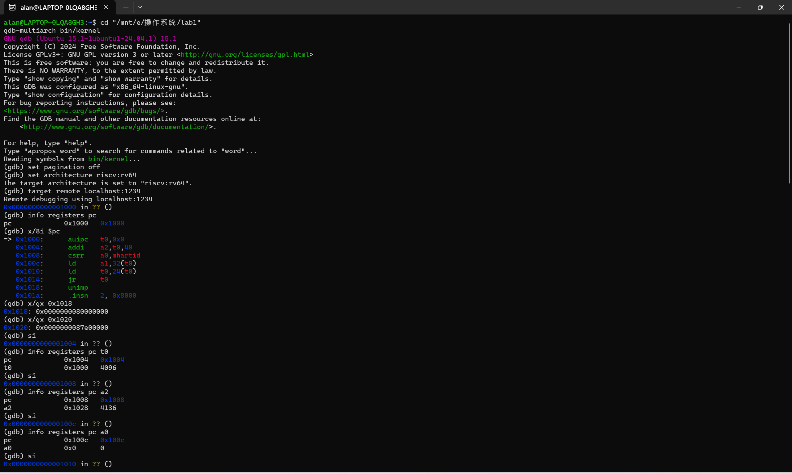
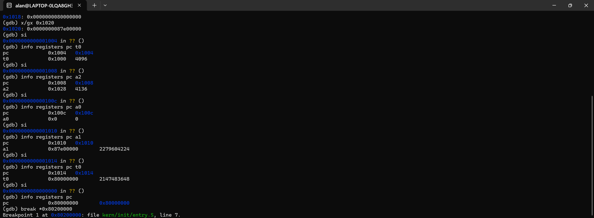
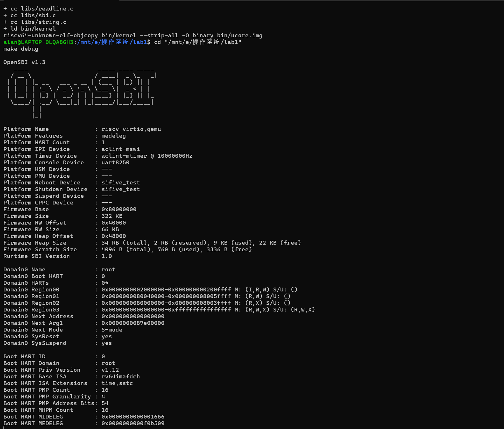
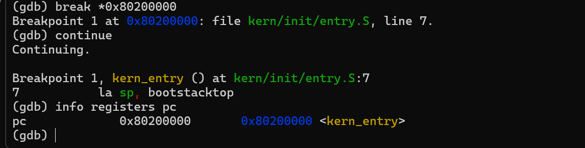

# 操作系统实验报告

## 实验基本信息

| 项目 | 内容 |
|------|------|
| 实验名称 | Lab 1：比麻雀更小的麻雀（最小可执行内核） |
| 小组成员 | 2414010-严子涵、2411641-薛健、2413777-施骅洋 |
| 完成日期 | 2026-10-11 |

### 小组分工

练习如何分工？

| 成员 | 负责的练习/模块 |
|------|----------------|
| 2414010-严子涵 | 整体逻辑与核心功能模块分析 |
| 2411641-薛健 | 练习二：使用 GDB 验证启动流程 |
| 2413777-施骅洋 | 练习一：理解内核启动中的程序入口操作 |

实验报告如何分工？

| 成员 | 负责的报告内容 |
|------|----------------|
| 2414010-严子涵 | 本章节整体逻辑线；各功能的核心函数或功能模块理解 |
| 2413777-施骅洋 | 实验重要知识点及其与 OS 原理的含义、关系和差异；OS 原理中重要但本实验没有对应上的知识点 |

---

## 一、实验目的

操作系统本身也是一个程序。本实验探讨的就是在操作系统还没有运行的时候，谁来把它放进内存，又是谁让 CPU 开始执行它。我们顺着机器启动的过程，搭起一个最小的内核。

按照指导书的安排，这个内核只需要完成一件很直观的事情：输出启动信息，然后进入无限循环。要让这件事情发生，却需要先解决几个基础问题：代码应该放在哪里，第一条指令是什么，C 函数使用的栈从哪里来，以及没有现成标准库时怎样输出字符。通过本实验，我们希望理解链接脚本、交叉编译、固件引导和内核初始化之间的联系，并掌握用 QEMU 和 GDB 观察这些过程的方法。

本次实验的内容主要包括：阅读内核的构建和启动代码，理解内核的内存布局与入口设置；分析从 SBI 字符输出到 `cprintf()` 格式化输出的封装过程；完成入口指令分析和 GDB 启动跟踪两道练习。它们共同回答的是：一个不依赖已有操作系统运行时的内核，怎样从几段源代码变成真正开始执行的程序。

---

## 二、实验环境

本实验以 QEMU 的 `virt` 机器模拟 64 位 RISC-V 计算机，通过 OpenSBI 完成固件阶段的初始化并进入内核。源码使用 RISC-V 交叉工具链编译，GDB 加载带有符号信息的 `bin/kernel`，通过远程调试接口观察 QEMU 中的 CPU。

练习二的调试记录来自小组成员在 Windows 与 WSL Ubuntu 下的实验环境。该次记录使用 QEMU 8.2.2、GDB Multiarch 15.1 和 OpenSBI v1.3，项目目录为 `E:\操作系统\lab1`，对应 WSL 路径 `/mnt/e/操作系统/lab1`。下文保留这次实际记录中的地址、命令和观察结果。

你们使用的 AI 工具

| 成员 | AI 编程工具 | 底层模型 | 备注 |
|------|------------|---------|------|
| 2414010-严子涵 | [WorkBuddy] | DeepSeek v4.1 Flash | |
| 2411641-薛健 | [Codex] | GPT 6.1 Sol | |
| 2413777-施骅洋 | [ChatGPT] | GPT-6 | |

**说明：**

- **AI 编程工具**：指具体使用的终端工具、编辑器插件、桌面应用或浏览器界面。
- **底层模型**：指该工具使用的大语言模型及版本。

---

## 三、实验整体逻辑分析

### 3.1 本章节的逻辑主线

我们对本章逻辑的理解是：先把内核安放到机器能够执行的位置，再为内核准备最基本的运行环境，接着让内核能够输出信息，最后通过编译、运行和调试把整条链验证一遍。

指导书首先介绍 OpenSBI、ELF 和二进制镜像，是为了说明内核从何而来、由谁接手，以及编译结果为什么还要经过转换。随后介绍链接脚本和入口代码，解决“放在哪里”和“从哪里开始”的问题。在 `kern_init()` 中看到 `cprintf()` 后，再顺着这个需求向下寻找输出接口，从 SBI 的单字符服务逐层封装出格式化输出。最后用 Makefile 把各部分构建起来，在 QEMU 中运行，再用 GDB 回看启动过程。

这个顺序有明确的依赖关系。没有正确的布局和入口，CPU 就找不到应该执行的指令；没有可用的栈，后面的 C 函数就缺少必要的调用条件；没有最底层的字符输出，格式化函数即使算出了字符串，也没有地方把它送出去。等这些条件都具备了，才有可能看到内核自己的第一条输出。

本章还有两条需要放在一起理解的线。一条是构建过程，发生在内核运行之前：

```text
C / 汇编源码 → 目标文件 → 链接得到 bin/kernel → 转换得到 bin/ucore.img
```

另一条是 CPU 的执行过程：

```text
加电复位 → MROM → OpenSBI → kern_entry → kern_init → 格式化输出 → 无限循环
```

前一条线决定代码和数据的布局，后一条线按照这个布局执行。链接时约定的地址、QEMU 实际加载的地址，以及固件最后跳转的地址，需要彼此对得上。

### 3.2 功能的逐步实现

首先确定固件与内核之间的启动约定。我们需要知道内核将被放到哪个地址，以及 CPU 从哪里开始执行，才能安排后续的代码布局。

接着通过链接脚本组织代码段和数据段，并确定 `kern_entry` 这个入口。入口汇编设置启动栈，再转入 `kern_init()`，由它清零 BSS，建立 C 代码需要的初始状态。

然后围绕输出启动信息这一需求，从 OpenSBI 的单字符服务出发，依次封装 `sbi_call()`、`sbi_console_putchar()`、`cons_putc()` 和格式化输出函数，最终使 `kern_init()` 能够调用 `cprintf()`。

最后利用 Makefile 完成交叉编译、链接和镜像转换，在 QEMU 中运行内核，并用 GDB 观察复位代码、OpenSBI 与内核之间的交接。这样，构建过程与执行过程就通过实际的地址和调试记录连接起来了。

---

## 四、实验内容与实现

### 功能模块：最小可执行内核的构建、启动与输出

**负责人：** 2414010-严子涵（核心函数与功能模块分析）

#### 模块功能描述

**涉及的核心函数：**

本次实验的功能模块及实现代码均由老师提供，我们主要阅读已有代码，理解各模块的功能和联系，并通过调试观察启动过程，不涉及功能代码的编写或修改。下面列出分析中涉及的核心函数；链接脚本、Makefile 和汇编入口也是重要模块，但不适合用 C 函数签名来表示。

```c
int kern_init(void) __attribute__((noreturn));
void *memset(void *s, char c, size_t n);
uint64_t sbi_call(uint64_t sbi_type, uint64_t arg0,
                  uint64_t arg1, uint64_t arg2);
void sbi_console_putchar(unsigned char ch);
void cons_putc(int c);
int cprintf(const char *fmt, ...);
int vcprintf(const char *fmt, va_list ap);
void vprintfmt(void (*putch)(int, void *), void *putdat,
              const char *fmt, va_list ap);
```

**功能说明：**

这个模块将源码构建成内核文件，按约定的布局加载并进入内核，为 C 代码准备栈和数据初始状态，然后通过固件服务输出启动信息。各部分的功能与相互关系如下。

##### 固件与引导：内核之前已经有程序在运行

在本次 QEMU `virt` 环境中，CPU 复位后从 `0x1000` 处的 MROM 代码开始执行。这段代码很短，主要准备硬件线程编号、设备树地址和下一阶段启动信息，随后跳转到 `0x80000000` 处的 OpenSBI。复位地址由具体平台决定，不能把 `0x1000` 理解为所有 RISC-V 处理器都必须使用的地址。

OpenSBI 运行在 M 模式，负责建立固件层的运行环境，然后把控制权交给运行在 S 模式的内核。进入内核以后，它仍然能够响应 SBI 服务请求。因此，OpenSBI 不只参与启动，也是内核运行时可以调用的固件服务提供者。

在当前实验的 QEMU 启动配置中，镜像加载由模拟器完成。原 Makefile 使用 `-device loader,file=...,addr=0x80200000` 指定加载位置，练习二最终成功的命令则使用 `-kernel bin/kernel`。我们应把镜像已经进入内存和 CPU 已经跳转到内核区分开来：前者是加载，后者是执行流程的交接。入口断点命中证明内核已经开始接管执行，不能据此推断 OpenSBI 曾经从磁盘读取过内核。

##### 链接脚本：为代码和数据确定位置

`tools/kernel.ld` 负责把各个目标文件中的节组织成内核的布局。我们认为它是源码与启动约定之间的连接点：源码中只有函数名和变量名，而 CPU 最终面对的是具体地址上的指令和数据。

脚本中的 `OUTPUT_ARCH(riscv)` 指定输出架构，`ENTRY(kern_entry)` 指定 ELF 入口符号，`BASE_ADDRESS = 0x80200000` 和 `. = BASE_ADDRESS` 则让内核布局从约定的地址开始。这里的 `.` 是链接器的位置计数器，随着各节的放置向后移动。`ENTRY` 设置的是入口信息；入口代码实际位于何处，还取决于节的排列和链接结果，不能只写一个入口符号就认为代码必然排在镜像开头。

主要的节包括 `.text`、`.rodata`、`.data`、`.sdata` 和 `.bss`。它们分别保存指令、只读常量、已初始化的可写数据、小数据和需要零初始化的数据。这样划分可以帮助链接器组织程序，也为后续设置不同的内存权限提供基础。本实验尚未通过页表把这些权限真正落实到各个页面。

`. = ALIGN(0x1000)` 将位置计数器向上调整到 4096 字节的整数倍；如果已经对齐，就保持原值。这里的对齐单位就是 `0x1000` 字节。

脚本还定义了 `etext`、`edata` 和 `end` 等边界符号。它们不是在 C 文件中分配的普通变量，而是链接器给出的地址。`kern_init()` 使用 `edata` 和 `end` 找到需要清零的内存范围，说明构建过程不仅生成了指令，也为运行时初始化提供了边界信息。

##### 汇编入口：先准备栈，再进入 C 函数

`kern/init/entry.S` 中的 `kern_entry` 是内核最先执行的入口。它只做两步：把 `bootstacktop` 的地址放入 `sp`，然后通过 `tail kern_init` 转入 C 语言初始化函数。代码很短，但它建立了后续函数调用所需要的基础。

启动栈空间由汇编文件中的 `.space KSTACKSIZE` 预留。当前代码将这段空间放在 `.data` 中，`KSTACKPAGE` 为 2，页面大小为 4096 字节，因此启动栈大小为 8192 字节。空间是在构建时静态预留的，执行 `la sp, bootstacktop` 时只是设置寄存器，不会再调用内存分配器。栈向低地址增长，所以初始栈指针指向高地址端。

`tail kern_init` 不建立一个等待返回的普通调用关系。当前 `kern_init()` 被声明为 `noreturn`，最终也确实停留在无限循环中，因此没有返回入口汇编的需要。这里让我们看到，内核的 C 代码同样依赖调用约定和栈，只是这些条件需要由启动代码自己准备。两条指令的具体分析见练习一。

##### kern_init：建立初始状态并给出启动反馈

`kern/init/init.c` 中的 `kern_init()` 是汇编入口之后的 C 语言入口。它依次清零 BSS 区域、输出启动信息、进入无限循环。

第一步调用 `memset(edata, 0, end - edata)`。`edata` 位于已初始化数据之后，`end` 位于 BSS 之后，因此这段代码将两者之间的区域置零，让需要零初始化的静态存储期对象具有正确的初始值。`memset()` 来自项目自己的 `libs/string.c`，它把指定范围的字节设置为给定值。我们不能仅凭模拟器中的内存碰巧是零，就省略内核应当承担的初始化工作。

第二步通过 `cprintf()` 输出启动字符串。这条消息说明执行已经到达 C 初始化代码，也用到了栈、字符串常量、格式化函数和底层字符输出。它是多个环节共同工作的结果，因此对最小内核而言是一条很有用的调试反馈。

最后的 `while (1)` 使内核一直保持执行。内核没有普通应用程序那样的上层运行时可供返回，本实验也没有实现下一步的任务调度，所以先停留在这里。这是主动执行的循环，会持续占用 CPU，不能把它等同于已经实现了空闲进程或者处理器休眠。

##### SBI 与控制台：把固件服务封装为内核接口

`libs/sbi.c` 中的 `sbi_call()` 是调用固件服务的核心。它把服务编号放入 `a7`，把参数放入 `a0`、`a1`、`a2`，执行 `ecall`，再从 `a0` 取回返回值。这里使用内联汇编，是为了在 C 代码中按约定操作寄存器并执行特定机器指令。

当前字符输出采用旧式 SBI 控制台调用约定，`SBI_CONSOLE_PUTCHAR` 的编号为 1。`sbi_console_putchar()` 把一个字符交给 `sbi_call()`，`kern/driver/console.c` 中的 `cons_putc()` 再把它封装成内核控制台的单字符输出接口。这一层虽然简单，却让上面的输出函数不用直接接触服务编号和汇编指令。

SBI 调用与普通函数调用有一个关键差别：它需要通过异常机制越过特权边界。在本实验的环境中，内核从 S 模式发出请求，由 M 模式的 OpenSBI 处理，然后返回内核继续执行。这里的服务调用方式与用户程序请求内核服务有相似之处，但调用双方不同；本实验还没有实现用户态到内核态的系统调用接口。

输出是本章实际使用的主线。当前 `cons_init()`、`kbd_intr()` 和 `serial_intr()` 仍是空函数；源码虽然保留了 `cons_getc()` 等输入接口，并声明了 `sbi_console_getchar()`，本地 `sbi.c` 中并没有实现这个字符输入函数。因此，这里不能因为存在接口名称，就认为键盘中断、输入缓冲和完整控制台交互已经完成。

##### 格式化输出：从一个字符到一条消息

`kern/libs/stdio.c` 和 `libs/printfmt.c` 共同完成格式化输出。完整的调用关系可以写成：

```text
cprintf → vcprintf → vprintfmt → cputch → cons_putc
        → sbi_console_putchar → sbi_call → ecall → OpenSBI
```

`cprintf()` 接收格式字符串和可变参数，用 `va_start`、`va_end` 管理参数列表，再交给 `vcprintf()`。`vcprintf()` 建立字符计数器，调用 `vprintfmt()`，最后返回输出字符数。

`vprintfmt()` 负责解释格式字符串。普通字符直接交给输出回调；遇到 `%s`、`%d`、`%x` 等格式标记，则取出相应参数并转换为字符。数字输出主要由 `printnum()` 完成，它先递归处理高位，再输出当前低位，从而按照正常阅读顺序打印数字。这个过程需要前面准备好的调用栈。

`cputch()` 是连接格式化逻辑和实际设备输出的回调：每输出一个字符，就调用一次 `cons_putc()`，同时增加计数。格式化函数只负责“得到哪些字符”，回调负责“字符送到哪里”。同一份格式化逻辑还可以通过不同回调写入内存缓冲区，项目中的 `snprintf()` 就使用了这种方式。

`cputchar()` 直接输出一个字符，`cputs()` 则逐个输出字符串中的字符并补上换行。它们与 `cprintf()` 共用底层字符接口，但不需要做完整的格式解析。这种分层让内核最上面的初始化代码可以直接写出一条格式化消息，不必关心每个字符怎样交给固件。

##### Makefile、ELF 与镜像：把源码变成可执行的内核

Makefile 与 `tools/function.mk` 把构建步骤组织成依赖关系。交叉编译器先把 C 和汇编源码变成目标文件，链接器再按照 `kernel.ld` 生成 `bin/kernel`，最后通过 `objcopy` 转换得到 `bin/ucore.img`。工具链运行在宿主环境中，生成的指令却属于 RISC-V，这就是交叉编译。

内核不能直接依赖宿主系统的标准库。当前构建使用 `-nostdinc`、`-nostdlib` 等选项，基础类型、字符串操作和格式化输出都由项目提供。编译选项中的 `-g` 保留调试信息，使 GDB 能把机器地址和函数名、源码行对应起来。

`bin/kernel` 是 ELF 文件，包含入口、节和符号等信息，适合调试和检查；`bin/ucore.img` 是通过 `-O binary` 生成的裸二进制数据，不带 ELF 的头部和调试符号，也不会自行说明应该从哪里执行。它的加载位置由启动配置约定。转换改变的是文件组织方式，并没有重新编译其中的机器指令。

BSS 的运行时空间与镜像中的有效数据也需要区分。不能笼统地认为转成裸二进制后就一定会为 BSS 写入同样大小的零字节；本实验通过链接器边界符号和启动清零代码来满足零初始化要求。

构建完成后，QEMU 提供模拟机器，GDB 提供观察和控制执行的手段。`make debug` 中的 `-s` 开启调试服务，`-S` 暂停 CPU；GDB 加载 ELF 符号后远程连接，就能查看指令、寄存器和内存。本章最后加入调试，正是为了把前面关于布局和交接的理解变成可以观察的结果。

### 练习一：理解内核启动中的程序入口操作

**负责人：** 2413777-施骅洋

内核启动时，OpenSBI 将控制权交给内核入口 `kern_entry`。这两条指令依次完成**初始化内核栈**和**进入 C 语言初始化函数**。

**1. `la sp, bootstacktop`：设置内核栈指针**

`la` 是“加载地址”的伪指令，将 `bootstacktop` 的地址写入栈指针寄存器 `sp`，相当于：

```text
sp = bootstacktop 的地址
```

`entry.S` 中通过下面的代码预留启动栈空间：

```asm
bootstack:
    .space KSTACKSIZE
bootstacktop:
```

其中，`bootstack` 是这段空间的低地址，`bootstacktop` 是高地址端。RISC-V 的栈向低地址增长，因此初始 `sp` 应指向 `bootstacktop`。

**目的：** 为内核建立可用的栈，使后续 C 函数能够保存寄存器、返回地址和局部变量。它加载的是栈顶的地址，不是该地址中的数据，也不会清空栈空间。

**2. `tail kern_init`：跳转到内核初始化函数**

`tail` 是尾调用伪指令，将程序执行位置转移到 `kern_init`，且不会像普通 `call` 那样把新的返回地址写入 `ra`。我们当前的编译结果中，它被优化成了直接跳转指令：

```asm
j kern_init
```

**目的：** 在栈准备好之后，把控制权从汇编入口交给 C 语言函数，开始内核初始化。当前 `kern_init` 会清零 BSS 区域、输出启动信息，然后进入无限循环；它被标记为 `noreturn`，不会返回，因此无需保留返回到 `kern_entry` 的地址。

整个过程是：

```text
OpenSBI → kern_entry → 设置 sp → 跳转 kern_init → 执行内核初始化
```
### 练习二：使用 GDB 验证启动流程

**负责人：** 2411641-薛健

#### 1. 实验目标与调试方法

本练习使用 QEMU 模拟 RISC-V 计算机，并通过 GDB 远程调试，观察 CPU 从加电复位到进入内核第一条指令的过程。重点记录初始指令地址、最初几条指令的作用，以及控制权从复位代码、OpenSBI 转交给内核的过程。

项目位于 Windows 的 `E:\操作系统\lab1`，对应的 WSL 路径为 `/mnt/e/操作系统/lab1`。本次使用 QEMU 8.2.2 和 GDB Multiarch 15.1，GDB 加载 `bin/kernel` 中的内核调试符号。

在两个 WSL Ubuntu 终端中进入项目目录。最终成功的 QEMU 启动命令为：

```bash
cd "/mnt/e/操作系统/lab1"
qemu-system-riscv64 -machine virt -nographic -bios default -kernel bin/kernel -s -S
```

其中，`-kernel bin/kernel` 指定内核文件；`-bios default` 使用默认 OpenSBI 固件；`-s` 开启监听 1234 端口的 GDB 服务；`-S` 使 CPU 在启动时暂停，以便从复位位置开始观察。

在另一个终端启动 GDB：

```bash
cd "/mnt/e/操作系统/lab1"
gdb-multiarch bin/kernel
```

在 GDB 中逐条输入：

```gdb
set pagination off
set architecture riscv:rv64
target remote localhost:1234
```

连接成功后，GDB 显示 CPU 停在 `0x0000000000001000`。由于内核符号不包含复位代码和 OpenSBI 的函数信息，这些位置显示为 `?? ()`，属于正常情况。

#### 2. 复位地址与最初指令

执行以下命令查看初始 PC 和附近的指令：

```gdb
info registers pc
x/8i $pc
```

实际观察结果为：

```text
pc             0x1000   0x1000
=> 0x1000:      auipc   t0,0x0
   0x1004:      addi    a2,t0,40
   0x1008:      csrr    a0,mhartid
   0x100c:      ld      a1,32(t0)
   0x1010:      ld      t0,24(t0)
   0x1014:      jr      t0
```

因此，本实验使用的 QEMU `virt` 机器在复位后首先执行的是 `0x1000` 处的 MROM 复位代码，而不是直接执行操作系统内核。这是该模拟机器的复位地址，并非所有 RISC-V 硬件统一规定的地址。

进一步读取复位代码使用的数据：

```gdb
x/gx 0x1018
x/gx 0x1020
```

结果为：

```text
0x1018: 0x0000000080000000
0x1020: 0x0000000087e00000
```

`0x1018` 中保存下一阶段固件入口地址 `0x80000000`，`0x1020` 中保存设备树地址 `0x87e00000`。这些位置属于数据区域，`x/8i` 将其显示为 `unimp` 等内容，是把数据按指令解码的结果，不表示 CPU 会顺序执行它们。

#### 3. 单步验证复位代码进入 OpenSBI

使用 `si` 每次执行一条机器指令，并通过 `info registers` 查看执行后的寄存器变化。实际记录如下：

| 指令地址 | 指令 | 执行后的关键结果 | 功能分析 |
|----------|------|------------------|----------|
| `0x1000` | `auipc t0,0x0` | `pc=0x1004`，`t0=0x1000` | 将当前指令地址作为后续地址计算的基准 |
| `0x1004` | `addi a2,t0,40` | `pc=0x1008`，`a2=0x1028` | 将启动信息结构的地址传给下一阶段固件 |
| `0x1008` | `csrr a0,mhartid` | `pc=0x100c`，`a0=0` | 读取当前硬件线程编号，本次为 0 |
| `0x100c` | `ld a1,32(t0)` | `pc=0x1010`，`a1=0x87e00000` | 从 `0x1020` 读取设备树地址，提供硬件描述信息 |
| `0x1010` | `ld t0,24(t0)` | `pc=0x1014`，`t0=0x80000000` | 从 `0x1018` 读取固件入口地址 |
| `0x1014` | `jr t0` | `pc=0x80000000` | 跳转到 OpenSBI，将控制权交给固件 |

执行最后一条跳转指令后，GDB 的实际输出为：

```text
(gdb) info registers pc
pc             0x80000000       0x80000000
```

由此可见，最初六条指令主要完成地址计算、启动参数准备和固件入口跳转。更完整的运行环境初始化由后续 OpenSBI 完成。

#### 4. 验证进入内核第一条指令

在重新连接的调试会话中，设置内核入口断点并继续执行：

```gdb
break *0x80200000
continue
info registers pc
```

实际输出为：

```text
Breakpoint 1 at 0x80200000: file kern/init/entry.S, line 7.
Continuing.

Breakpoint 1, kern_entry () at kern/init/entry.S:7
7           la sp, bootstacktop

pc             0x80200000       0x80200000 <kern_entry>
```

断点实际命中 `kern_entry`，且 PC 为 `0x80200000`，证明 OpenSBI 已将控制权交给内核。此时 CPU 即将执行第一条指令 `la sp, bootstacktop`，该指令尚未执行，达到本练习要求的跟踪终点。

复位代码的单步观察和成功命中内核入口的记录分别采集于两次调试会话，用于验证启动流程的不同阶段。

#### 5. 结论

根据实际调试结果，本实验的启动路径可以概括为：

```text
0x1000：MROM 复位代码，准备硬件线程编号、设备树及固件启动信息
    ↓
0x80000000：OpenSBI，初始化运行环境并准备进入内核
    ↓
0x80200000：kern_entry，开始执行操作系统内核
```

复位代码负责准备启动参数并跳转到固件，OpenSBI 负责固件阶段的初始化与控制权交接，内核从链接脚本指定的入口位置开始运行。本次的内核加载由 QEMU 启动配置完成，不能仅凭入口断点命中就认为观察到了 OpenSBI 从磁盘读取内核的过程。

---

## 五、测试与验证

**测试截图：**

### 5.1 复位指令与启动参数

GDB 连接 QEMU 后，初始 PC 为 `0x1000`。查看复位指令及内存中的启动数据，并单步观察 `t0`、`a2`、`a0` 的变化，与练习二中的记录一致。



### 5.2 单步进入 OpenSBI

执行读取设备树地址、读取固件入口地址和跳转指令后，PC 到达 `0x80000000`，验证了复位代码向 OpenSBI 的控制权交接。



### 5.3 编译结果与固件启动

截图记录了链接生成 `bin/kernel`、转换生成 `bin/ucore.img` 的输出，以及 OpenSBI v1.3 的启动信息。这张图来自前期的 `make debug` 会话，其中 `Domain0 Next Address` 为零，因此它能说明构建和固件启动的情况，还不能单独证明内核入口已经被执行。后续采用练习二中记录的 `-kernel bin/kernel` 启动方式，成功命中了内核入口。



### 5.4 命中内核入口断点

继续执行后，断点命中 `kern_entry`，PC 为 `0x80200000`，对应 `entry.S` 中尚未执行的第一条指令 `la sp, bootstacktop`。这一结果验证了最后一次交接：CPU 已经从固件进入我们的内核。



这几组记录分别验证构建、复位代码、固件入口和内核入口。按源码继续执行，`kern_init()` 将清零 BSS，打印 `(THU.CST) os is loading ...`，然后进入无限循环。入口断点处的截图尚未展示这段 C 代码的后续输出，应与已经观察到的入口结果分开理解。

---

## 六、实验总结与收获

### 对操作系统的理解

#### 1. 本实验中的重要知识点及其与 OS 原理的联系

##### 引导过程与操作系统启动

本实验通过 MROM、OpenSBI 和内核之间的控制权交接，展示了 OS 原理中的分阶段引导。操作系统开始运行之前，需要前面的程序为它建立执行条件。本实验由 QEMU 预先加载镜像，再由 OpenSBI 进入内核，没有完整展示真实机器从存储设备读取内核的过程。

##### 内存布局、链接与初始化

链接脚本确定代码、数据和入口的位置，`kern_init()` 通过 BSS 清零建立数据初始状态，对应原理中的程序链接、装入与运行环境初始化。链接时约定的地址需要与实际加载位置一致，程序才能正确执行。不过，本实验使用固定的内存布局，尚未实现动态内存分配和虚拟内存管理。

##### 启动栈与执行上下文

`la sp, bootstacktop` 为 C 函数调用准备可用的栈，对应运行上下文中保存局部数据和调用信息的需要。这说明内核同样依赖调用约定，只是运行条件要由启动代码自己建立。本实验只有一块静态启动栈，没有多个任务各自的栈，也没有上下文切换。

##### 特权级与服务调用

内核通过 `ecall` 从 S 模式请求 M 模式的 OpenSBI 服务，体现了原理中通过受控入口跨越特权边界的思想。它与系统调用使用相似的硬件机制，但调用双方不同：通常的系统调用发生在用户程序与内核之间，本实验的 SBI 调用发生在内核与固件之间。

##### 分层输出与设备抽象

从 `cprintf()` 到控制台接口，再到 SBI 字符输出，体现了分层设计与设备抽象。上层处理格式和内容，下层负责把字符送到设备，因此各部分可以分别理解和复用。本实验借助固件完成输出，没有自行实现完整的设备驱动、输入缓冲和中断处理。

#### 2. OS 原理中重要但本实验尚未对应的知识点

##### 进程、线程与处理器调度

进程和线程用于组织多个执行任务，调度负责分配 CPU 并切换执行上下文。本实验只有一条启动路径，没有进程控制块、就绪队列和时间片调度，最后的无限循环也不能代替任务管理。

##### 物理内存与虚拟内存

完整的操作系统需要分配和回收物理页面，通过页表建立地址空间，并处理缺页和页面置换。本实验只使用静态布局与启动栈；虽然涉及页大小和地址对齐，但没有建立分页与地址翻译机制。

##### 内核中断、用户态与系统调用

操作系统需要响应定时器和设备中断，并让用户程序通过系统调用请求服务。本实验中的 SBI 异常由固件处理，内核尚未建立自己的完整陷阱处理流程，也没有运行用户程序。

##### 并发同步与进程间通信

锁、信号量等机制用于协调共享资源访问，进程间通信用于交换数据，死锁分析则关注资源等待造成的停滞。本实验没有并发任务和资源竞争场景，因此尚未涉及这些机制的具体实现。

##### 文件系统、设备管理与资源保护

文件系统负责组织持久化数据，设备管理负责协调 I/O 请求，资源保护则限制不同程序能够访问的范围。本实验只借助固件输出字符，没有文件操作、完整设备管理和用户进程隔离等功能。

#### 3. 实验总结

通过阅读老师提供的代码和使用 GDB 调试，我们理解了从复位到进入内核的启动过程，也看清了链接布局、栈初始化、BSS 清零和输出接口之间的联系。最小内核虽然功能简单，却把后续实验所依赖的启动基础展示得很清楚。

调试让这些理解有了具体依据。观察 PC、寄存器和内存的变化，能够判断当前执行到了哪个阶段，以及控制权如何交接，而不只是根据代码猜测运行过程。

### AI 辅助理解与报告整理的经验

AI 帮助我们梳理模块关系、解释指令和提供组织报告的思路，但具体地址与运行结果仍需结合源码和调试记录核对。本次实验我们主要完成代码的理解、分析和说明，因此报告也要区分代码已有的功能与实际观察到的结果。

---
